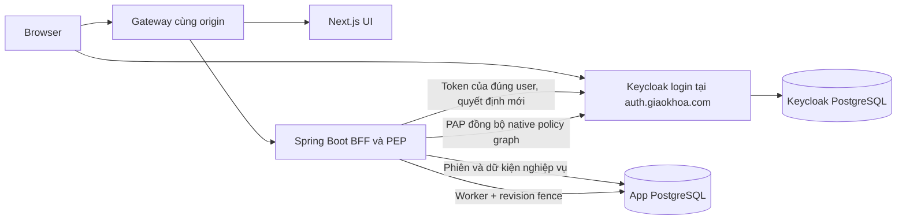

# Implementation Plan: Bộ khung xác thực và phân quyền đa trung tâm

**Branch**: `main` | **Date**: 2026-11-05 | **Spec**: [spec.md](spec.md)

**Input**: `specs/001-multitenant-access/spec.md`; yêu cầu bổ sung: backend Spring Boot, frontend Next.js.

Feature identifier từ công cụ là `001-multitenant-access`. Bản thiết kế gốc ngày 05/11 được đối chiếu lại với `origin/main` tại `f3d2e618be74f574c03d8301a04d9a0427bdbc98` ngày 12/11/2026; kết quả hiện hành ở [báo cáo hội tụ](../../docs/doi-chieu-spec-code-20261112.md). Các bảng ghi kiểm tra ngày lập kế hoạch là lịch sử thiết kế, không là chứng nhận nghiệm thu code hiện tại.

## Summary

Xây một Spring Boot modular monolith làm backend/BFF, Next.js App Router làm giao diện, PostgreSQL làm app database và Keycloak cung cấp danh tính cùng Authorization Services làm PDP. Spring giữ session/tokens phía server, điều phối membership và native policy graph, gọi quyết định mới cho từng cặp đối tượng–hành động và thực thi kết quả. Giao diện không có engine quyền hoặc session thứ hai.

Bản đầu vận hành đăng nhập, tenant/gói thủ công, thành viên, lớp/khóa đa môn, ghi danh từng môn, nhiều giáo viên cùng môn, chủ nhiệm và liên kết phụ huynh. Quyền học liệu/bài làm/kết quả được chứng minh bằng dữ liệu mẫu qua cùng đường quyền, không xây công cụ soạn/làm/chấm đề đầy đủ.

Thiết kế ưu tiên chứng minh native Keycloak và thu hồi quyền trước khi mở rộng CRUD. Kết luận từ tài liệu/source không thay thế gate tích hợp thật.

## Technical Context

**Language/Version**: Java 25; TypeScript và Node.js 24. Spring Boot 4.1.2; Next.js 16.4.5 App Router. Java/Node/PostgreSQL/Keycloak tận dụng baseline `.devcontainer/`; phiên bản được đối chiếu nguồn trong research.

**Primary Dependencies**: Spring Security OAuth2 Client/OIDC với HttpSessionOAuth2AuthorizedClientRepository, Spring Session JDBC và OIDC session correlation bền, Spring Data JPA/Hibernate, Flyway, Bean Validation; các phiên bản theo BOM Spring Boot. Keycloak 26.8.1 native Authorization Services/Admin API. Next.js/React theo phiên bản hỗ trợ của Next, npm lockfile; không thêm Auth.js, Redis, message broker hoặc custom Keycloak SPI cho bản đầu.

**Storage**: PostgreSQL 18.6 app-db, tách keycloak-db. Mỗi workspace một schema riêng khi đã kích hoạt (workspace keys/composite FKs trong từng schema); mặt phẳng public giữ dữ kiện hệ thống và dữ kiện của workspace chưa kích hoạt, được lọc bằng `workspace_id` ở truy vấn ứng dụng; không dùng RLS (xem Sổ B103). Canonical học liệu nguồn qua repository chuyên biệt sau quyết định quyền. Spring Session JDBC lưu phiên, Flyway quản lý schema theo hai dòng (hệ thống + tenant), Hibernate không validate toàn cục.

**Testing**: JUnit theo Spring Boot BOM. Unit `*Test` chạy Surefire, không Spring context; integration `*IT` chạy Failsafe qua `integration`/`it-pure`, Spring MOCK khi dùng context; backend E2E `*E2EIT` kèm `@Tag("e2e-backend")` chạy server RANDOM_PORT và HTTP thật bằng `RestTestClient.bindToServer()`. Cookie phiên JDBC và CSRF lấy theo hợp đồng thật. Playwright dùng Authorization Code thật, email qua Mailpit. PostgreSQL/Keycloak và runtime role thật trên stack TEST riêng; chỉ một lượt integration/native/browser nặng tại một thời điểm trên máy dùng chung. Lệnh bàn giao theo `AGENTS.md`/`backend/README.md`, không thay acceptance bằng compile hoặc kiểm chuỗi SQL.

**Target Platform**: Web tiếng Việt trên browser hiện đại; backend/Next chạy Linux; HTTP local phục vụ dev, HTTPS cho production. Cùng origin ứng dụng, Keycloak riêng tại `auth.giaokhoa.com`.

**Project Type**: Hai ứng dụng trong một repository: Spring backend/BFF và Next frontend; modular monolith, chưa tách microservice.

**Performance Goals**: Giữ SC-001/002/009 về thời gian thao tác/người dùng và SC-003–008 về tỷ lệ quyết định đúng. Chưa có cam kết tải hoặc p95 ở quy mô production. Đo số lời gọi PDP và thời gian projection trong gate; không tối ưu bằng cache allow làm giảm tính đúng.

**Constraints**: Một danh tính nhiều tenant, không role học sinh/giáo viên toàn cục; role/phân công cố định có phạm vi. Thu hồi từ request tiếp theo sau xác nhận thành công, không chờ token hết hạn. Gói cá nhân/trung tâm độc lập; hết hạn vẫn hoàn tất bài cũ theo lịch và nguồn quyền còn hiệu lực. Token không đưa vào browser, không bypass PDP, dữ liệu riêng không cache. MFA do vận hành tự cấu hình.

**Scale/Scope**: Baseline một Spring instance, một Next instance, app-db/keycloak-db riêng và gateway. Acceptance có hai trung tâm, hai lớp trong một trung tâm, khóa ba môn, hai giáo viên cùng môn, ba học sinh chọn môn, hai phụ huynh và các quan hệ/tài nguyên độc lập. Quy mô lớn, đa vùng, queue/broker và đa instance không là điều kiện bản đầu.

## Constitution Check

*GATE: Kiểm tra trước nghiên cứu và kiểm tra lại sau thiết kế.*

`.specify/memory/constitution.md` đang là template chưa có nguyên tắc được phê chuẩn. Không coi nội dung ví dụ/chỗ trống là quy định và không tự sửa/ban hành constitution trong lệnh này. Không có vi phạm nguyên tắc đã ban hành để ghi nhận; đây không phải tuyên bố dự án đã có constitution hoàn chỉnh.

| Kiểm tra theo chỉ dẫn người dùng/spec | Trước Phase 0 | Sau Phase 1 | Bằng chứng |
| --- | --- | --- | --- |
| Backend Spring Boot, frontend Next.js | Đạt | Đạt | Technical Context, cấu trúc và HTTP contract |
| Keycloak là PDP, không dựng engine quyền thứ hai | Đạt định hướng | Đạt thiết kế; runtime gate còn phải chạy | Research R3–R8, authorization contract |
| Giữ phạm vi bản đầu, không thêm custom role/MFA bắt buộc | Đạt | Đạt | Scope, domain model, fixed scopes |
| Khóa đa môn, phân công/ghi danh từng môn | Đạt | Đạt | Teaching model/API, scenarios T3/T4 |
| Cách ly tenant, phụ huynh đúng con, thu hồi tức thời | Đạt yêu cầu | Đạt thiết kế; chưa chứng minh runtime | Partition fence, native graph, validation gate |
| Chỉ tạo tài liệu thiết kế trong bước này | Đạt | Đạt | Các artifact Phase 0/1; chưa có code/migration/test suite |

Không có gate về nội dung nghiệp vụ bị bỏ qua hoặc được thay bằng một giả định giảm yêu cầu. Gate runtime đặt đầu implementation, có điều kiện dừng cụ thể.

## Project Structure

### Documentation (this feature)

```text
specs/001-multitenant-access/
├── spec.md
├── plan.md
├── research.md
├── data-model.md
├── quickstart.md
├── contracts/
│   ├── http-api.md
│   └── authorization.md
└── checklists/
    └── requirements.md
```

`tasks.md` do bước `$speckit-tasks` tạo sau; không tạo ở bước lập kế hoạch.

### Source Code (repository root)

Cấu trúc theo chín domain nghiệp vụ đã triển khai; module đủ lớn có `web`, `service`, `repository`, `model`, `dto`, hoặc package chức năng như `authorization`. `infrastructure` chứa plumbing persistence/tenant, không là domain nghiệp vụ thứ mười. Đường dẫn cũ trong task được tra theo bảng ánh xạ ở báo cáo hội tụ; không tạo class mới chỉ để khớp tên lịch sử.

```text
backend/
├── pom.xml
├── mvnw
├── .mvn/
└── src/
    ├── main/
    │   ├── java/com/giaokhoa/
    │   │   ├── identity/
    │   │   ├── tenancy/
    │   │   ├── subscriptions/
    │   │   ├── teaching/
    │   │   ├── guardians/
    │   │   ├── resources/
    │   │   ├── authorization/
    │   │   ├── verification/
    │   │   ├── infrastructure/
    │   │   └── shared/
    │   └── resources/
    │       └── db/
    │           ├── migration/
    │           └── migration-tenant/
    └── test/
        ├── java/com/giaokhoa/
        └── resources/
frontend/
├── package.json
├── package-lock.json
├── src/
│   ├── app/
│   ├── features/
│   └── lib/
└── tests/
    ├── unit/
    └── e2e/
infra/
├── compose.dev.yaml
├── compose.test.yaml
├── gateway/
└── keycloak/
    ├── baseline/
    └── fixtures/
.devcontainer/
```

**Structure Decision**: Một Maven application và một Next application là đủ. Package theo nghiệp vụ; `authorization` chứa PEP/PAP/projection/revision và Keycloak adapters. `verification` dùng cùng services/quyền; fixture chỉ đăng ký ở test/review. `/review` còn thiếu gate môi trường theo hợp đồng và được giữ là khoảng hở, không coi phiên đăng nhập là thay thế profile review. `infra` giữ cấu hình issuer/gateway/mail/test.

## Thiết kế tích hợp



- Gateway route `/api/*`, `/oauth2/*`, `/login/oauth2/*`, `/logout/connect/back-channel/keycloak` đến Spring; các trang đến Next. Inbound back-channel chỉ miễn browser CSRF/session authentication trên đúng protocol route và xác minh logout_token; browser logout vẫn có CSRF. Không xây Route Handlers lặp lại REST API chỉ để proxy.
- Server Components chỉ gọi Spring bằng cookie phiên của đúng request, không dùng cache/dữ liệu toàn tiến trình cho user/tenant. Mọi mutation do browser đến Spring và có CSRF.
- Một realm; Organizations cho directory. Các assignment sources dùng realm groups/user policies riêng có workspace ID, không dùng Organization groups trong group policy.
- Mỗi root permission gắn đúng resource-context và scope, kết hợp native graph. Từng source giữ AND các giới hạn; OR nguồn độc lập; eligibility và giới hạn bắt buộc không nằm ở nhánh OR có thể bypass.
- HTTP request dùng fresh decision cho từng cặp. Native batch decision có thể chỉ chứng minh một phần nên không được coi là phép AND. Không tái dùng allow/RPT cũ.
- Mutation domain ghi PENDING + operation bền, worker áp dụng graph và xác nhận READY; request được fence khi projection chưa cập nhật. Khóa và revision ngăn write commit sau một revoke đã xác nhận bằng quyết định cũ.
- Scope tăng quyền/tạo mới tách scope thu hồi để gói hết hạn vẫn bảo vệ được dữ liệu. Completion branch chỉ cho bài đã giao đúng lịch, vẫn cần nguồn quyền hiện hành.

## Phase 0 — Nghiên cứu đã hoàn tất

[research.md](research.md) ghi 12 quyết định, rationale và alternatives: baseline; BFF; native graph; Organizations/realm groups; fresh UMA; revision/fence; console boundary; gói/share; dữ liệu; web security; runtime gate; email verification/no-email accounts.

Các lựa chọn gốc có phương án kiểm chứng runtime và tiêu chí dừng; không được diễn đạt thành kết quả test đã pass. Đợt làm rõ ngày 12/11 bổ sung FR-055–057 từ NV-01/NV-02/NV-04 và giới hạn NV-05 vào FR-044. NV-03/NV-06 được giới hạn theo sản phẩm trung tâm và dữ liệu mẫu; NV-07 còn là tiền đề vận hành phải chốt trước dùng dữ liệu thật.

## Phase 1 — Dữ liệu, hợp đồng và kiểm chứng

- [data-model.md](data-model.md): entities/fields/FK/trạng thái, cách ly theo schema tenant, canonical source, provenance, subscription periods, projection/revision/durable operation.
- [contracts/http-api.md](contracts/http-api.md): session/CSRF, HTTP semantics, typed request/response fields, các route quản trị và luồng UI; fixture actions không bypass quyền.
- [contracts/authorization.md](contracts/authorization.md): resource/scope naming, native source graph, PDP request, đồng bộ/fence/concurrency, console boundary và 9 nhóm gate thật.
- [quickstart.md](quickstart.md): yêu cầu môi trường, lệnh dự kiến sau implementation, dữ kiện nghiệm thu và kết quả mong đợi. Không chứa implementation/migration/test suite đầy đủ.

## Thứ tự triển khai để bước tasks phân rã

1. Chứng minh một lát cắt OIDC session → native resource/scope decision → revoke cùng session với Keycloak/PostgreSQL thật; kiểm tra partial batch, time boundary, eligibility và PENDING failure. Chưa mở rộng CRUD khi gate chưa đạt.
2. Dựng cấu trúc Spring/Next, migrations, session/CSRF/logout, directory/workspaces, role templates, revision worker và lỗi chuẩn.
3. Vận hành tenant/gói thủ công, thành viên/lời mời/cấp học sinh và recovery tập trung; kiểm tra độc lập quyền personal/center.
4. Lớp/khóa đa môn, class roster, subject enrollments, nhiều giáo viên, chủ nhiệm và guardian links; có UI thực và các phép thử IDOR.
5. Metadata tài nguyên/version/library/license/provenance và sample actions/kết quả để hoàn thiện toàn bộ ma trận quyền cùng các trường hợp hết hạn/thu hồi.
6. E2E, restart/retry/concurrency/cache/CSRF/logout và nghiệm thu thời gian thao tác của spec. Không thêm tính năng nghiệp vụ ngoài phạm vi để làm demo.

## Rủi ro và điều kiện dừng

| Rủi ro | Xử lý trong thiết kế | Tiêu chí |
| --- | --- | --- |
| Token/claim/permission cũ còn quyền | Fresh PDP mỗi cặp, current realm groups/identity, không cache allow | Same-session revoke request tiếp theo bị từ chối |
| Projection lệch domain | Partition revision, durable operation, idempotency, retry/fail-closed | Không báo SUCCEEDED khi native quyền cũ còn hiệu lực |
| Revoke cạnh tranh với ghi | Khóa/revision quanh decide+commit, dependencies bất biến và kiểm tra lại | Sau revoke SUCCEEDED không commit mới từ stale decision |
| Source share bị bỏ qua khi fork | Provenance/gate dependencies và authorization context theo nơi dùng | Revoke chặn bản nhận/bản chỉnh sửa cần nguồn đó |
| Time policy khác precision/timezone | UTC giây, test đúng biên native, không dựa scheduler | Khớp quy ước `[start,end)`; chưa khớp thì gate chưa đạt |
| Một realm ép email cho issued student | Profile optional email, verifyEmail có điều kiện, origin server-controlled và eligibility gate | Issued không email login được; self-register chưa verified không có nghiệp vụ |
| Cache hoặc console edit làm rò tenant | No-store; console emergency fence/reconcile | Không trả dữ liệu cached sau đổi context/revoke |
| Native graph/fanout không đáp ứng | Đo ở gate trước mở rộng, chưa thêm JS/SPI/service khác | Ghi bằng chứng và chỉnh thiết kế có chủ đích; không hạ yêu cầu hoặc bypass PDP |

## Kiểm tra sau thiết kế

Đã giữ bộ quyền cố định và lựa chọn Spring Boot/Next.js/Keycloak. Không thêm custom role editor, MFA bắt buộc, payment automation, trình soạn hoặc sổ điểm hoàn chỉnh. Code và nhiều biên bản nghiệm thu đã có; gate #95 và nghiệm thu xuyên suốt vẫn chưa hoàn tất theo parent #2 tại thời điểm đối chiếu. Không phát biểu repository chỉ có thiết kế hoặc tạo lại các task đã có.

## Hội tụ sau đối chiếu 12/11/2026

- **Vai trò và hướng dẫn sử dụng**: [Bản đồ luồng](../../docs/luong-nghiep-vu-theo-vai-tro.md) nối vai trò → bước nghiệp vụ → kết quả/phủ định → FR/scenario → test. E2E dùng tag chuẩn Playwright `@flow-*`, `@role-*`, `@layer-*`; giữ project hiện có để không chạy trùng theo số vai. Phân biệt actor thực hiện hành vi được khẳng định với actor chỉ dựng fixture. Hướng dẫn người dùng chỉ mô tả UI đã có, không đưa policy/SQL/fixture vào thao tác sản phẩm.
- **Cách ly tenant**: Giữ quyết định #261 về JPA và hai dòng Flyway, không đưa RLS trở lại để khớp task cũ. Việc chuẩn bị schema chưa kích hoạt không hoàn thành mục tiêu mỗi workspace dùng schema riêng. Chuyển dữ kiện, đọc directory/period ở đúng context, fan-out revoke/correction và kiểm chứng nghiệp vụ trên tenant đã kích hoạt còn là đầu vào cutover. Runtime role dùng chung có grants trên các schema đã cấp; ranh giới namespace không thay authorization hoặc tự thành ACL riêng cho từng người dùng.
- **Bản nhận học liệu**: Nguồn hệ thống giữ tham chiếu; tenant → tenant copy-on-share theo #261. Resource/version cục bộ giữ provenance và gate grant, không tự cấp nhánh owner. `ResourceCopies`, `ResourceLibraryService`, `ResourcePolicyProjector` cùng sở hữu hành vi; spec/data-model không còn yêu cầu mọi lượt lưu đều giữ cùng ID cục bộ.
- **Hoàn thành đợt học**: Bổ sung COMPLETED và nguồn `read.published` riêng cho kết quả của chính học sinh; không tái dùng group ghi danh ACTIVE để mở nộp/giao bài. API/UI và migration mới thuộc task hội tụ; khóa tài khoản và thu hồi có chủ đích vẫn ưu tiên chặn.
- **Liên kết phụ huynh**: APPROVE cần `verificationRef`; người/thời điểm duyệt do server lưu. Không thêm module tải giấy tờ hay xác minh pháp lý; vận hành xác minh ngoài hệ thống cho cả center/personal có dữ liệu trẻ em, trong khi route guardian vẫn chỉ center.
- **Bài cũ và license**: Nộp phải giữ hạn/lượt; submit/grade/publish phải kiểm tra nguồn học liệu còn hiệu lực, gồm toàn bộ thành phần cần dùng. Không gate các hành động hoàn tất bằng gói hiện tại. `completionPolicy` tách GUARANTEED khỏi INTERRUPTIBLE; nguồn REVOCABLE không được dùng cho GUARANTEED; LONG_TERM hữu hạn cũng chưa đủ bảo đảm khi mới có `dueAt` mà chưa có hạn chấm/công bố. Thay giáo viên sau expiry cần gia hạn rồi cấp phân công mới, không có đường bàn giao vượt gói.
- **Ngoại lệ SQL**: Mục 10–13 của authorization contract ghi phạm vi thực tế; đây còn là quyết định cần kết luận trước đóng parent, không tự biến chúng thành bằng chứng mọi route đã dùng PDP. Không lấy fixture seed JDBC làm lý do duy nhất duy trì ngoại lệ khi viết kiểm chứng mới.
- **Nghiệm thu**: 56 scenarios gốc giữ bằng chứng lịch sử; 5 scenarios bổ sung đưa tổng hiện hành lên 61. Cần kiểm chứng lại các nhánh bị phát hiện thiếu (deadline/license/cutover/notification) và các yêu cầu mới; CI xanh ở revision cũ không thay những bằng chứng này. SC-001/002/009 cần người thật, không lấy kết quả tự động làm số liệu.
